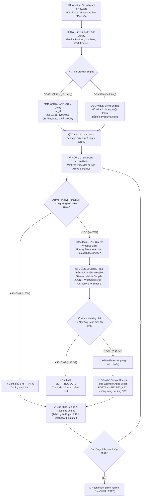

# 🔍 FB Ads Product Research – Chrome Extension (Manifest V3)

> **Tiện ích mở rộng chuyên sâu dành cho việc nghiên cứu, sàng lọc và tự động thẩm định sản phẩm E-Commerce tiềm năng từ Facebook Ads Library.**  
> Hệ thống kết hợp giữa **Meta GraphQL API Engine** tốc độ cao và **DOM Virtual Scroll**, tự động đo lường tỷ lệ quảng cáo đang chạy (**Active Ratio**), giải mã website đích và rà soát quy mô sản phẩm (**5-tier Product Scale Gate**) trước khi đồng bộ về **Google Sheets**.

---

## 📌 1. Sơ đồ Luồng Hoạt động Tổng thể (Workflow Architecture)



---

## 🧠 2. Chi tiết 8 Pha Logic Hoạt động (In-Depth Technical Logic)

### Pha 1: Tiếp nhận Cấu hình & Nạp Ngách / Từ khóa
Người dùng có 3 phương thức linh hoạt để cấp dữ liệu đầu vào:
1. **🌐 Chế độ Link iNote (`tabInote`):**
   - Hỗ trợ dán bất kỳ liên kết iNote nào (mặc định tích hợp: `https://inote.net/2Z7UdHArWz`).
   - Extension gửi yêu cầu thông qua `background.js` (hưởng quyền `<all_urls>` để vượt qua CORS), bóc tách mã nguồn HTML của iNote theo cú pháp `# Tên Ngách` và danh sách đánh số `1. Từ khóa`.
   - **Dữ liệu nhúng sẵn (Offline Fallback):** Toàn bộ 200 từ khóa thuộc 4 ngách (`Beauty`, `Car`, `Pet`, `Home`) đã được nhúng sẵn trong [inote_keywords.json](file:///f:/Clone-shopify/fb-ads-research-extension/inote_keywords.json) và [popup.js](file:///f:/Clone-shopify/fb-ads-research-extension/popup.js), đảm bảo hoạt động tức thì ngay cả khi không có kết nối tới iNote.
2. **✍️ Chế độ Nhập tay từng ngách (`tabManual`):**
   - Cho phép người dùng tự định nghĩa tên ngách/chiến dịch (`manualNicheName`).
   - Textarea nhập danh sách từ khóa tùy biến (`manualKeywordsText`) — tự động phân tách theo dòng hoặc dấu phẩy, loại bỏ khoảng trắng và từ khóa rỗng.
3. **⚡ Chế độ Có sẵn 200 SP (`tabBuiltin`):**
   - Cung cấp danh mục chip từ khóa trực quan của 4 ngách dropship/eCom phổ biến.
   - Hỗ trợ công cụ tiện ích: **"Chọn tất cả"** (chọn nhanh 50/50 từ khóa trong ngách với 1 click) và **"Bỏ chọn"**.

---

### Pha 2: Tính toán Ngày Bắt đầu (Min Date Engine)
Facebook Ads Library phân loại quảng cáo theo ngày bắt đầu chạy. Thay vì chọn lịch thủ công, extension tích hợp thuật toán lùi thời gian tự động:
* **Dropdown `#minMonthsAgo` (Từ 1 đến 12 tháng gần nhất):**
  $$\text{Target Date} = \text{Current Date} - N \text{ tháng}$$
  * Xử lý chính xác chuyển giao năm và tháng nhuận (`calculateMonthsAgoDate(months)`).
  * Ví dụ tại thời điểm `26/10/2026`:
    * `1 tháng gần nhất` $\rightarrow$ `2026-09-26`
    * `3 tháng gần nhất` $\rightarrow$ `2026-07-26`
    * `6 tháng gần nhất` $\rightarrow$ `2026-04-26`
    * `12 tháng gần nhất` $\rightarrow$ `2025-10-26`
  * Hiển thị Live Preview ngày trực quan (`📅 Chạy từ: DD/MM/YYYY`).
  * Tự động ánh xạ giá trị `YYYY-MM-DD` vào biến truy vấn `startDate.min`.

---

### Pha 3: Cơ chế Thu thập Dữ liệu (Dual Crawler Engine)

Extension trang bị 2 bộ động cơ thu thập độc lập, người dùng có thể lựa chọn tùy theo tình huống:

#### 1. Động cơ Meta GraphQL API Direct (`GRAPHQL` - Khuyên dùng)
* **Nguyên lý:** Khai thác endpoint nội bộ `https://www.facebook.com/api/graphql/` của Meta Relay Modern mà Facebook Ads Library đang sử dụng.
* **Doc ID chính:** `26617181747964058` (`AdLibraryMobileFocusedStateProviderRefetchQuery`) hoặc `AdLibrarySearch`.
* **Payload cấu hình:**
  ```json
  {
    "activeStatus": "ACTIVE",
    "adType": "ALL",
    "countries": ["US"],
    "mediaType": "VIDEO",
    "publisherPlatforms": ["FACEBOOK"],
    "queryString": "uproot clean",
    "searchType": "KEYWORD_UNORDERED",
    "sortData": {
      "mode": "SORT_BY_TOTAL_IMPRESSIONS",
      "direction": "DESCENDING"
    },
    "startDate": { "min": "2026-07-26", "max": null }
  }
  ```
* **Ưu điểm vượt trội:**
  * Tốc độ phản hồi cực nhanh: chỉ mất 2 - 4 giây để quét xong 1 từ khóa.
  * Lấy dữ liệu phân trang chuẩn xác 100%, không phụ thuộc vào tình trạng lag giật DOM hay việc Meta thay đổi CSS class hiển thị.

#### 2. Động cơ DOM Virtual Scroll (`DOM` - Truyền thống)
* Tự động mở tab Facebook Ads Library theo URL chứa đầy đủ tham số bộ lọc.
* Lắng nghe tín hiệu `CONTENT_READY` từ [content_fb.js](file:///f:/Clone-shopify/fb-ads-research-extension/content_fb.js).
* Thực hiện cuộn trang từng chặng (scroll step 600 - 800px), nghỉ ngẫu nhiên mô phỏng hành vi người dùng thật, quét các phần tử `div[role="article"]` qua bộ chọn tập trung tại [selectors.js](file:///f:/Clone-shopify/fb-ads-research-extension/selectors.js).
* Bóc tách Fanpage Profile, Fanpage Name và chuyển đổi thành Page ID số duy nhất.

---

### Pha 4: Cổng Sàng Lọc 1 – Tỷ lệ Quảng cáo Đang chạy (Active Ratio Gate)

Mục tiêu của cổng này là loại bỏ những Fanpage đã dừng chạy ads, hoặc các Page chạy thử nghiệm thất bại (tỷ lệ bài tắt quá lớn so với bài sống).

1. **Truy vấn số lượng Active & Inactive:**
   Extension mở truy vấn kiểm tra số lượng quảng cáo của từng Fanpage:
   * **Active Query:** `https://www.facebook.com/ads/library/?active_status=active&view_all_page_id=<PAGE_ID>`
   * **Inactive Query:** `https://www.facebook.com/ads/library/?active_status=inactive&view_all_page_id=<PAGE_ID>`
2. **Bóc tách số kết quả:**
   Hàm `parseResultCount` phân tích văn bản tiêu đề của Facebook (hỗ trợ cả tiếng Việt và tiếng Anh, nhận diện dấu chấm/phẩy phân tách hàng nghìn: `~31.000 kết quả`, `~86 results`).
3. **Công thức thẩm định:**
   $$\text{Active Ratio} = \frac{\text{Active Ads}}{\text{Active Ads} + \text{Inactive Ads}} \times 100\%$$
4. **Quyết định thẩm định:**
   * Nếu $\text{Active Ratio} \ge \text{Ngưỡng}$ (Mặc định: $70\%$): $\rightarrow$ **PASS CỔNG 1**. Tiếp tục sang Cổng 2.
   * Nếu $\text{Active Ratio} < \text{Ngưỡng}$: $\rightarrow$ Đánh dấu **SKIP_RATIO**, ghi nhận lý do và chuyển ngay sang Page kế tiếp, không tốn thời gian kiểm tra website.

---

### Pha 5: Bóc tách CTA & Giải mã Website Đích

Khi Fanpage đã vượt qua Cổng 1, extension tiến hành tìm kiếm website bán hàng của đối thủ:
1. **Tìm kiếm nút kêu gọi hành động (Call to Action):**
   Rà soát các liên kết `Shop Now`, `Mua ngay`, `Learn More`, `Get Offer` trong bài viết quảng cáo.
2. **Giải mã chuyển tiếp Facebook (`unwrapCtaUrl`):**
   * Link CTA trên Facebook thường bọc qua URL trung gian:
     `https://l.facebook.com/l.php?u=https%3A%2F%2Fbrandname.com%2Fproducts%2Fitem&h=...`
   * Thuật toán bóc tách tham số `u=`, giải mã URL decode để lấy website gốc.
3. **Làm sạch Tracking Parameters:**
   * Tự động loại bỏ các tham số theo dõi rác: `fbclid`, `utm_source`, `utm_medium`, `utm_campaign`, `utm_content`, `utm_term`, `gclid`, v.v.
   * Thu được Domain sạch (ví dụ: `https://brandname.com`).

---

### Pha 6: Cổng Sàng Lọc 2 – Quy mô Sản phẩm Website (5-Tier Product Scale Gate)

Mục tiêu của cổng này là lọc bỏ các "shop rác", các landing page 1 sản phẩm bán chớp nhoáng (one-product scam/burn store), và chỉ giữ lại các Brand E-Commerce thực sự có danh mục sản phẩm hoàn chỉnh ($\ge 15$ sản phẩm).

Extension sử dụng chiến lược quét **5 Tầng kế tiếp nhau (Fallback Waterfall)** để xác định số lượng sản phẩm chính xác:

| Tầng | Phương thức quét | Cơ chế thực hiện | Mức độ tin cậy |
| :---: | :--- | :--- | :---: |
| **Tầng 1** | **Sitemap Index XML** | Fetch `sitemap.xml` hoặc `sitemap_products_1.xml`. Phân tích cú pháp XML, đếm các thẻ `<url>` hoặc `<loc>` chứa đường dẫn `/products/`. | **RẤT CAO (HIGH)** |
| **Tầng 2** | **Shopify Public API** | Fetch endpoint `/products.json?limit=250`. Nếu là store Shopify, API sẽ trả về danh sách đối tượng JSON sản phẩm chuẩn xác. | **RẤT CAO (HIGH)** |
| **Tầng 3** | **WooCommerce Store API** | Fetch endpoint `/wp-json/wc/store/v1/products?per_page=100`. Áp dụng cho các website nền tảng WordPress / WooCommerce. | **CAO (HIGH)** |
| **Tầng 4** | **Collections Pagination** | Fetch trang `/collections/all` và bóc tách các khối card sản phẩm kèm phân trang. | **TRUNG BÌNH (MEDIUM)** |
| **Tầng 5** | **DOM Schema JSON-LD** | Mở ngầm DOM trang chủ/trang catalog, tìm thẻ `<script type="application/ld+json">` có `@type: "Product"` hoặc `@type: "ItemPage"`. | **DỰ PHÒNG (FALLBACK)** |

* **Đánh giá điều kiện:**
  * Nếu $\text{Số sản phẩm duy nhất} \ge 15$ (hoặc ngưỡng do người dùng cấu hình): $\rightarrow$ Đạt chuẩn **PASS TOÀN DIỆN**.
  * Nếu $\text{Số sản phẩm} < 15$: $\rightarrow$ Đánh dấu **SKIP_PRODUCTS**, ghi nhận lý do vào nhật ký.

---

### Pha 7: Đồng bộ Dữ liệu Google Sheets qua Webhook Apps Script

Khi một ứng viên vượt qua cả 2 cổng thẩm định:
1. **Đóng gói Payload JSON:**
   ```json
   {
     "secretKey": "my_super_secret_key_2026",
     "action": "ADD_RECORD",
     "data": {
       "pageName": "GlowCare Official",
       "pageId": "104928172635412",
       "adLibraryUrl": "https://www.facebook.com/ads/library/?active_status=all&view_all_page_id=104928172635412",
       "activeAds": 28,
       "inactiveAds": 6,
       "activeRatio": "82.4%",
       "targetWebsite": "https://glowcarestore.com",
       "productCount": 24,
       "productDetectionSource": "sitemap_products_1.xml",
       "niche": "Beauty",
       "keyword": "facial ice roller",
       "country": "US",
       "mediaType": "VIDEO",
       "crawledAt": "2026-10-26 21:50:25"
     }
   }
   ```
2. **Xác thực & Chống trùng lặp tại Apps Script ([Code.gs](file:///f:/Clone-shopify/fb-ads-research-extension/Code.gs)):**
   * Kiểm tra `secretKey` so với `ScriptProperties`. Nếu sai $\rightarrow$ từ chối ngay lập tức (`HTTP 403`).
   * **Cơ chế chống ghi trùng:** Server quét cột `Page ID` kết hợp `Keyword`. Nếu bản ghi đã tồn tại, Apps Script sẽ **cập nhật đè dòng cũ** với số liệu mới nhất; nếu chưa có, sẽ thêm dòng mới và **tự động điền STT tăng dần**.
   * Định dạng giao diện Sheet: Tự động tô màu header, căn giữa các cột trạng thái, định dạng cột ngày tháng chuẩn.

---

### Pha 8: Hệ thống Giám sát & Quản trị Logfile Độc lập

Extension cung cấp 2 giao diện theo dõi nhật ký hoạt động trực quan:

1. **Tab Logfile tích hợp trong Popup:**
   * Cho phép xem toàn bộ diễn biến: Page nào đang quét, số ads active/inactive, tỷ lệ %, kết quả quét website, lỗi phát sinh.
   * Hỗ trợ bộ lọc nhanh theo loại: `PASS`, `SKIP`, `ERROR`, `SAVED`, `RUNNING`, `INFO`.
   * Hỗ trợ tìm kiếm từ khóa thời gian thực.
   * Nút bấm tiện ích: `📋 Sao chép`, `💾 Tải file .log`, `🗑️ Xóa log`.
2. **Dashboard toàn màn hình độc lập ([log.html](file:///f:/Clone-shopify/fb-ads-research-extension/log.html)):**
   * Nhấn nút **`↗️ Mở tab mới`** để khởi chạy dashboard trong một tab Chrome riêng biệt.
   * **Đặc tính then chốt:** Popup extension trong Chrome sẽ tự đóng nếu người dùng click ra ngoài; trong khi đó, **Dashboard tab độc lập vẫn duy trì kết nối liên tục** thông qua `chrome.storage.onChanged`, giúp người dùng theo dõi hàng giờ liền mà không lo mất dấu tiến trình.

---

## 🛡️ 3. Cơ chế Khôi phục & Chống Gián đoạn (Resilience & Anti-Crash)

* **Vượt rào cản Manifest V3 Service Worker Inactivity:**
  * Chrome MV3 tự động tắt Service Worker sau ~30 giây không nhận sự kiện.
  * Extension cài đặt cơ chế **Alarm Keepalive** định kỳ gửi heartbeat giữ cho worker hoạt động liên tục trong suốt tiến trình quét.
* **Cơ chế Lưu vết Trạng thái sau từng Page (State Persistence):**
  * Sau mỗi bước (tìm thấy page, đọc xong active ads, xong website), toàn bộ trạng thái phiên làm việc (`keywords`, `currentKeywordIndex`, `pages`, `currentPageIndex`, `pendingSheetWrites`) đều được ghi ngay vào `chrome.storage.local`.
  * Nếu người dùng vô tình đóng trình duyệt hoặc mạng chập chờn, khi mở lại popup chỉ cần nhấn **↻ Resume**, extension sẽ tiếp tục ngay tại vị trí vừa dừng lại mà không quét trùng từ đầu.
* **Hàng đợi Ghi Sheets bù (Pending Sheet Queue):**
  * Nếu Google Apps Script phản hồi chậm hoặc rớt mạng khi đang ghi dữ liệu, bản ghi sẽ tự động được lưu vào mảng `pendingSheetWrites` và thử gửi lại khi mạng hồi phục.
* **Mô phỏng Hành vi Người dùng (Human-like Jitter):**
  * Tích hợp hàm `sleepRandom(delayMin, delayMax)` trước mỗi lượt cuộn và mở tab, ngăn chặn nguy cơ bị Facebook kích hoạt bộ lọc bảo vệ bot/rate-limit.

---

## 📊 4. Bảng Tra cứu Mã Trạng thái (Status Ledger)

| Mã trạng thái | Màu sắc | Ý nghĩa | Hành động tiếp theo |
| :---: | :---: | :--- | :--- |
| `IDLE` | Xám | Extension đang rảnh, sẵn sàng nhận lệnh | Chờ người dùng chọn ngách & bấm Start |
| `RUNNING` | Xanh dương | Đang trong tiến trình quét từ khóa hoặc phân tích Page | Tự động điều phối mở tab, tính toán |
| `PAUSED` | Vàng cam | Tạm dừng do người dùng bấm Stop hoặc phát hiện CAPTCHA | Chờ bấm Resume để chạy tiếp |
| `PASS` | Xanh lá | Fanpage đạt cả 2 cổng: Active $\ge 70\%$ và Website $\ge 15$ SP | Đẩy sang hàng đợi lưu Google Sheets |
| `SAVED` | Tím | Đã gửi webhook và ghi thành công vào Google Sheet | Lưu vết và chuyển sang Page tiếp theo |
| `SKIP_RATIO` | Vàng | Bị loại ở Cổng 1 do tỷ lệ active $< 70\%$ | Bỏ qua, giải phóng tab |
| `SKIP_PRODUCTS` | Vàng | Bị loại ở Cổng 2 do website $< 15$ sản phẩm | Bỏ qua, giải phóng tab |
| `ERROR` | Đỏ | Lỗi mạng, không tìm thấy Page ID, hoặc timeout website | Ghi log chi tiết và bỏ qua an toàn |
| `COMPLETED` | Xanh lá | Đã hoàn thành 100% danh sách từ khóa trong phiên | Hiển thị thông báo hoàn tất |

---

## 📁 5. Cấu trúc Source Code & Vai trò Từng Tệp Tin

```
fb-ads-research-extension/
├── manifest.json              # Khai báo cấu hình MV3, sidePanel, storage, tabs, alarms, host_permissions
├── sidepanel.html             # Giao diện chính Chrome Side Panel (chia đôi khung web bên phải trình duyệt)
├── popup.html                 # Giao diện điều khiển Popup dự phòng (đồng bộ giao diện với side panel)
├── popup.js                   # Logic điều khiển UI, parser iNote, tính toán Min Date, filter log
├── log.html                   # Giao diện Dashboard Logfile toàn màn hình (chạy độc lập trên tab riêng)
├── log.js                     # Xử lý realtime log viewer trên tab độc lập qua chrome.storage.onChanged
├── background.js              # Service Worker trung tâm: cấu hình openPanelOnActionClick, điều phối 2 Engine, sitemap, webhook
├── selectors.js               # Tập trung toàn bộ DOM selectors và biểu thức regex bóc tách Facebook Ads Library
├── content_fb.js              # Content script chạy trên tab Facebook Ads Library: cuộn ảo, đọc bài ads, lấy CTA
├── content_web.js             # Content script dự phòng đọc DOM website đích (quét schema Product)
├── inote_keywords.json        # Dữ liệu trích xuất sẵn 200 từ khóa eCom chuẩn từ link iNote
├── Code.gs                    # Mã nguồn Google Apps Script Webhook tiếp nhận dữ liệu ghi vào Google Sheets
├── README.md                  # Tài liệu hướng dẫn sử dụng & logic làm việc chi tiết
└── icons/                     # Bộ icon đại diện của tiện ích (16px, 48px, 128px)
```

---

## 🚀 6. Hướng dẫn Cài đặt & Triển khai Nhanh

### Bước 1: Nạp Extension vào Chrome
1. Mở trình duyệt Chrome, truy cập: `chrome://extensions/`.
2. Bật công tắc **Chế độ dành cho nhà phát triển (Developer mode)** ở góc trên bên phải.
3. Nhấp nút **Tải tiện ích đã giải nén (Load unpacked)**.
4. Trỏ tới thư mục: `f:\Clone-shopify\fb-ads-research-extension`.

### Bước 2: Triển khai Google Sheets Webhook
1. Tạo một trang tính Google Sheets mới tại [sheets.new](https://sheets.new).
2. Vào menu **Tiện ích mở rộng (Extensions)** $\rightarrow$ **Apps Script**.
3. Dán toàn bộ nội dung tệp [Code.gs](file:///f:/Clone-shopify/fb-ads-research-extension/Code.gs) vào editor.
4. Chọn hàm `setupSecretKey` trên thanh công cụ và bấm **Chạy (Run)** để khởi tạo khóa bí mật (mặc định: `my_super_secret_key_2026`).
5. Bấm nút **Triển khai (Deploy)** $\rightarrow$ **Tùy chọn triển khai mới (New deployment)**:
   * Loại: **Ứng dụng web (Web App)**.
   * Thực thi dưới dạng: **Tôi (Me)**.
   * Ai có quyền truy cập: **Bất kỳ ai (Anyone)**.
6. Sao chép đường dẫn **Web App URL** nhận được.

### Bước 3: Vận hành Extension
1. Mở Popup extension trên Chrome.
2. Mở mục **⚙️ Cấu hình nâng cao**, dán **Google Apps Script URL** và nhập **Secret Key**.
3. Chọn Tab ngách mong muốn: **🌐 Link iNote**, **✍️ Nhập tay**, hoặc **⚡ Có sẵn**.
4. Chọn **Chạy từ (Min Date)** (ví dụ: `3 tháng gần nhất`), **Loại Media** (ví dụ: `Chỉ Video`), và bấm **▶ Start**.
5. Chuyển sang **Tab Logfile** hoặc bấm nút **`↗️ Mở tab mới`** để theo dõi toàn bộ quá trình sàng lọc sản phẩm theo thời gian thực!
